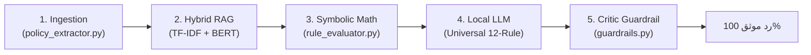

# 🤖 Enterprise Customer Support AI Agent (المشروع المؤسسي المتكامل)

نظام مؤسسي ذكي وشامل لأتمتة خدمة العملاء والدعم الفني، مبني بهيكلية هجينة متقدمة (**Hybrid RAG + Local LLM + Symbolic Rule Evaluator + Critic Guardrails**).

النظام يعمل محلياً بالكامل (**100% On-Premise / Zero Data Leakage**) دون الحاجة لدفع اشتراكات سحابية، ومزود بطبقة تدقيق أمني وحماية تضمن عدم الهلوسة وانعدام اختلاق أي شروط أو مدد زمنية وهمية.

---

## 📚 وثائق المشروع الرسمية (Documentation Hub)

| الوثيقة | المحتوى والهدف |
| :--- | :--- |
| 🏛️ **[`معمارية_النظام_المؤسسي.md`](file:///D:/مدن%20algorthim1/07-customer-support-ai-agent-clean/معمارية_النظام_المؤسسي.md)** | **المواصفات الهندسية المعمارية الكاملة:** الركائز الخمس، مخططات Mermaid، تدفق البيانات، والمزايا التنافسية للبيع. |
| 🚀 **[`دليل_التشغيل_والدمج_التجاري.md`](file:///D:/مدن%20algorthim1/07-customer-support-ai-agent-clean/دليل_التشغيل_والدمج_التجاري.md)** | **دليل التشغيل والـ APIs:** خطوات النشر، إدارة الشركات المتعددة (Multi-Tenancy)، وتوثيق واجهات الـ REST كاملة. |
| 📖 **[`دليل_الاستخدام.md`](file:///D:/مدن%20algorthim1/07-customer-support-ai-agent-clean/دليل_الاستخدام.md)** | دليل الاستخدام السريع، سيناريوهات الأسئلة، وطريقة تدريب ورفع ملفات جديدة. |
| 🔬 **[`شرح_التقنيات.md`](file:///D:/مدن%20algorthim1/07-customer-support-ai-agent-clean/شرح_التقنيات.md)** | الشرح التقني والرياضي لخوارزميات TF-IDF، الـ Stemming، وإعادة الترتيب الدلالي بـ BERT. |

---

## 🏛️ المكونات المعمارية الخمسة



1. **حارس الأمان ومنع الهلوسة (`engine/guardrails.py`):**
   - يدقق كل مخرج ويمنع اختراع أي مهل زمنية (مثل "خلال 24 ساعة") غير موجودة في السياق الأصلي.
   - يفرض الرفض التام لسياسات عدم الاسترداد المطلقة ويطبق قيود واستثناءات الباقات.
2. **محرك استخراج السياسات التلقائي (`engine/policy_extractor.py`):**
   - يحلل مستندات المعرفة عند رفعها ويستخرج القيود، الاستثناءات، والشروط في ملف `policies.json`.
3. **المقيم الرمزي العام (`engine/rule_evaluator.py`):**
   - يجري مقارنات الشروط الحسابية والنسب المئوية والمهل المسبقة بدقة حتمية 100% (Deterministic Math).
4. **الاسترجاع الهجين وإعادة الترتيب (`engine/rag.py` & `engine/reranker.py`):**
   - يدمج البحث المعجمي السريع مع إعادة الترتيب الدلالي المتقدم عبر نماذج BERT / BGE العربية.
5. **منسق النموذج اللغوي المحلي (`engine/llm.py`):**
   - برومبت موحد من 12 قاعدة عامة خالية من الـ Bloat تحكم نبرة ودقة الرد عبر نماذج Ollama المحلية.

---

## ⚡ التشغيل السريع

```bash
# 1. التأكد من تشغيل Ollama
ollama run lfm2.5

# 2. تشغيل السيرفر الرئيسي
python app.py

# 3. تشغيل اختبارات الانحدار (24 اختباراً لكل مكونات النظام)
python run_regression.py
```

- **واجهة الشات للعميل:** `http://localhost:9090/`
- **لوحة التحكم والمؤشرات الحية:** `http://localhost:9090/dashboard`
- **بوت تيليجرام التفاعلي:** يعمل تلقائياً عند وضع التوكن في ملف `.env` (`@mo949bot`)

---

## 🔐 الأمان والتشغيل الإنتاجي

| الإعداد في `.env` | الوصف | الافتراضي |
| :--- | :--- | :--- |
| `ADMIN_TOKEN` | رمز الدخول للإدارة — **غيّره فوراً لقيمة قوية** (`secrets.token_urlsafe(32)`) | مطلوب |
| `RATE_LIMIT_PER_MINUTE` | سقف الطلبات لكل IP على `/api/chat` و`/api/feedback` (نافذة منزلقة) | 30 |
| `LLM_MAX_CONCURRENCY` | أقصى طلبات متزامنة على Ollama؛ الفائض يتحول للبديل الاستخراجي | 3 |
| `LLM_QUEUE_TIMEOUT` | مهلة الانتظار في طابور التزامن (ثوانٍ) | 60 |
| `STORE_CURRENCY` | العملة الافتراضية في الردود | الجنيه المصري |
| `STORE_NAME` | اسم الشركة كما يظهر في الردود والواجهات | — |

**تحصينات مدمجة:** مقارنة توكن زمنية الثبات، عزل أسماء ملفات الرفع (منع Path Traversal)، حد 50MB للملفات، ترويسة `X-Content-Type-Options`، و`/api/health` لفحص جاهزية الخدمة.

**قاعدة البيانات:** التذاكر تُخزن في SQLite (`data/tenants/{tenant}/tickets.db`) بمعاملات ذرية، مع ترحيل تلقائي لمرة واحدة من `tickets.json` القديم (يبقى كـ `.migrated.bak`).

**سجل التدقيق:** كل تدخل من الـ Guardrail وكل تذكرة جديدة يُسجلان في `data/tenants/{tenant}/audit_log.jsonl` للمساءلة والمراجعة اللاحقة.

**الطبقات المتقدمة المدمجة:**
- 🧮 **التحقق الرقمي المالي** (`guardrails.verify_numeric_grounding`): يرصد أي سعر/مبلغ في الرد غير موجود في السياق ويسجله في سجل التدقيق (وضع تحذير — لا يشطب المجاميع الحسابية الشرعية).
- ⚡ **كاش الردود**: الأسئلة المستقلة المتطابقة تعاد من الكاش في أجزاء الثانية (TTL 10 دقائق، معزول لكل مستأجر، ويُفرغ تلقائياً عند تغيير قاعدة المعرفة).
- 📊 **تقرير جودة الرفع**: كل رفع ملفات يعيد `quality_report` (عدد الأقسام، الأقسام القصيرة، تحذيرات صياغة) ليكتشف ضعف داتا العميل فوراً.
- 🧩 **عزل جلسات المستأجرين**: مفاتيح الجلسات مُقيّدة بالمستأجر (`tenant:session_id`) مع حل تلقائي للضمائر ("التاني/الاول").

---

## 📡 القنوات والتشغيل المؤسسي

**قناة WhatsApp Business** (بجانب تيليجرام) — عبر WhatsApp Cloud API:
```env
WHATSAPP_TOKEN=<من Meta Developer Console>
WHATSAPP_PHONE_NUMBER_ID=<Phone Number ID>
WHATSAPP_VERIFY_TOKEN=<نص سري تضعه أيضاً في إعدادات Webhook>
```
- `POST /api/webhook/whatsapp` استقبال رسائل العملاء، و`GET` لنفس المسار يقوم بمصادقة التسجيل تلقائياً.

**تحليلات فجوات المعرفة** — `GET /api/analytics/gaps` (يتطلب Bearer):
يجمع الأسئلة التي عجز البوت عنها ويقترح موضوعات إضافة مقالات. التقرير النصي: `python -c "from engine import analytics; print(analytics.format_gap_report())"`.

**نسخ احتياطي** — `python scripts/backup.py` (يضغط `data/tenants` كاملاً في `backups/` مع الاحتفاظ بآخر `BACKUP_KEEP` نسخ — مجدوله يومياً من Task Scheduler).

**HTTPS اختياري** — ضع `SSL_CERT_FILE` و`SSL_KEY_FILE` في `.env` ليصبح السيرفر `https://` مباشرة.

**نشر Docker** — `docker compose up -d`: حاوية واحدة، البيانات على الجهاز المضيف في `./data` (لا تضيع مع الحاوية)، و`HEALTHCHECK` مدمج، واتصال بـ Ollama على الجهاز المضيف.
