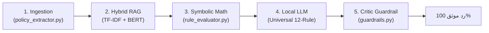

# 🤖 Enterprise Customer Support AI Agent (المشروع المؤسسي المتكامل)

نظام مؤسسي ذكي وشامل لأتمتة خدمة العملاء والدعم الفني، مبني بهيكلية هجينة متقدمة (**Hybrid RAG + Local LLM + Symbolic Rule Evaluator + Critic Guardrails**).

النظام يعمل محلياً بالكامل (**100% On-Premise / Zero Data Leakage**) دون الحاجة لدفع اشتراكات سحابية، ومزود بطبقة تدقيق أمني وحماية تضمن عدم الهلوسة وانعدام اختلاق أي شروط أو مدد زمنية وهمية.

---

## 📚 وثائق المشروع الرسمية (Documentation Hub)

| الوثيقة | المحتوى والهدف |
| :--- | :--- |
| 🏛️ **[`معمارية_النظام_المؤسسي.md`](file:///D:/مدن%20algorthim1/07-customer-support-ai-agent-clean/معمارية_النظام_المؤسسي.md)** | **المواصفات الهندسية المعمارية الكاملة:** الركائز الخمس، مخططات Mermaid، تدفق البيانات، والمزايا التنافسية للبيع. |
| 🚀 **[`دليل_التشغيل_والدمج_التجاري.md`](file:///D:/مدن%20algorthim1/07-customer-support-ai-agent-clean/دليل_التشغيل_والدمج_التجاري.md)** | **دليل التشغيل والـ APIs:** خطوات النشر، إدارة الشركات المتعددة (Multi-Tenancy)، وتوثيق واجهات الـ REST كاملة. |
| 📖 **[`دليل_الاستخدام.md`](file:///D:/مدن%20algorthim1/07-customer-support-ai-agent-clean/دليل_الاستخدام.md)** | دليل الاستخدام السريع، سيناريوهات الأسئلة، وطريقة تدريب ورفع ملفات جديدة. |
| 🔬 **[`شرح_التقنيات.md`](file:///D:/مدن%20algorthim1/07-customer-support-ai-agent-clean/شرح_التقنيات.md)** | الشرح التقني والرياضي لخوارزميات TF-IDF، الـ Stemming، وإعادة الترتيب الدلالي بـ BERT. |

---

## 🏛️ المكونات المعمارية الخمسة



1. **حارس الأمان ومنع الهلوسة (`engine/guardrails.py`):**
   - يدقق كل مخرج ويمنع اختراع أي مهل زمنية (مثل "خلال 24 ساعة") غير موجودة في السياق الأصلي.
   - يفرض الرفض التام لسياسات عدم الاسترداد المطلقة ويطبق قيود واستثناءات الباقات.
2. **محرك استخراج السياسات التلقائي (`engine/policy_extractor.py`):**
   - يحلل مستندات المعرفة عند رفعها ويستخرج القيود، الاستثناءات، والشروط في ملف `policies.json`.
3. **المقيم الرمزي العام (`engine/rule_evaluator.py`):**
   - يجري مقارنات الشروط الحسابية والنسب المئوية والمهل المسبقة بدقة حتمية 100% (Deterministic Math).
4. **الاسترجاع الهجين وإعادة الترتيب (`engine/rag.py` & `engine/reranker.py`):**
   - يدمج البحث المعجمي السريع مع إعادة الترتيب الدلالي المتقدم عبر نماذج BERT / BGE العربية.
5. **منسق النموذج اللغوي المحلي (`engine/llm.py`):**
   - برومبت موحد من 12 قاعدة عامة خالية من الـ Bloat تحكم نبرة ودقة الرد عبر نماذج Ollama المحلية.

---

## ⚡ التشغيل السريع

```bash
# 1. التأكد من تشغيل Ollama
ollama run lfm2.5

# 2. تشغيل السيرفر الرئيسي
python app.py
```

- **واجهة الشات للعميل:** `http://localhost:9090/`
- **لوحة التحكم والمؤشرات الحية:** `http://localhost:9090/dashboard`
- **بوت تيليجرام التفاعلي:** يعمل تلقائياً عند وضع التوكن في ملف `.env` (`@mo949bot`).
