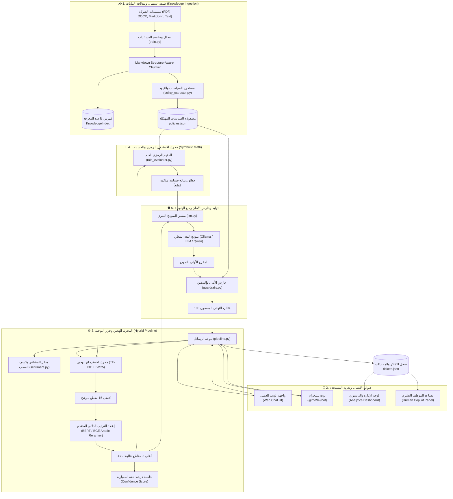
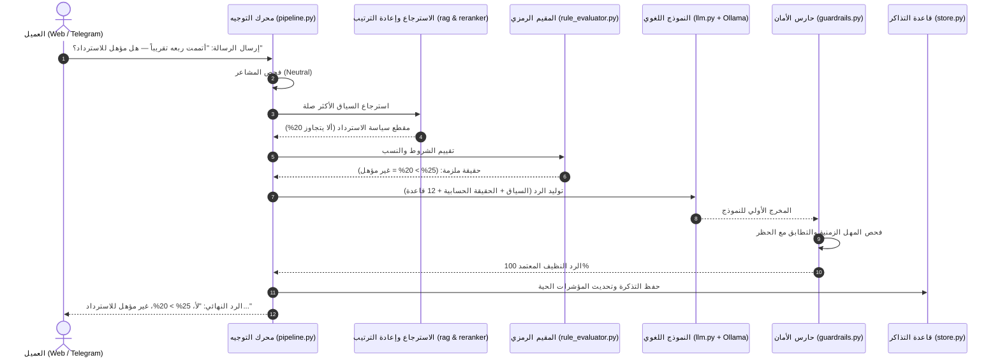

# 🏛️ معمارية النظام المؤسسي الشامل — Enterprise AI Customer Support Agent

> **وثيقة معمارية تقنية رسمية (Technical Architecture Document)**  
> **الإصدار:** 2.5 Enterprise Edition  
> **البيئة:** On-Premise / Local Inference / Private Cloud  
> **الترخيص والجاهزية:** جاهز للعرض والتشغيل التجاري (Commercial Grade)

---

## 1. الملخص التنفيذي (Executive Summary)

تم تصميم هذا النظام ليكون حلاً مؤسسياً متكاملاً لأتمتة خدمة العملاء والدعم الفني للشركات، مع التركيز على ثلاث ركائز نادرة في سوق الذكاء الاصطناعي الحالي:
1. **الخصوصية والأمان التام (100% On-Premise & Data Privacy):** معالجة كافة البيانات والاستدلال محلياً دون إرسال أي معلومة لطرف ثالث أو سحابة عامة.
2. **ضمان انعدام الهلوسة (Zero-Hallucination Guarantee):** مزود بطبقة حماية برمجية حاسمة (`Critic Guardrail Layer`) تفحص وتدقق كل رد قبل وصوله للعميل، وتمنع اختراع أي شروط أو مدد زمنية غير موجودة نصاً.
3. **التشغيل الفوري لأي مجال (Plug & Play Generalized Architecture):** لا يحتاج النظام لأي تعديل يدوي في الكود عند تغيير نشاط الشركة أو رفع مستندات جديدة؛ حيث يقوم بهيكلة القواعد والاستثناءات والشروط الرياضية آلياً.

---

## 2. المخطط المعماري الكلي (System Topology & Data Flow)



---

## 3. تفكيك المكونات البرمجية الأساسية (Component Breakdown)

### 3.1. حارس الأمان والتدقيق البرمجي العام (`engine/guardrails.py`)
يعمل هذا المكون كحاجز تدقيق نهائي (Final Quality & Policy Gate) يمر عليه رد نموذج الذكاء الاصطناعي قبل عرضه للمستخدم:
- **التدقيق الزمني (Timeframe Grounding):** يستخرج بصورة آلية أي مدد زمنية وردت في الرد (مثل: `خلال 24 ساعة`، `خلال 3 أيام`، `أول أسبوع`). يفحص هل هذه المدد موجودة في السياق المسترجع أم مخترعة؟
  - إذا كانت مخترعة والسياق ينص على حظر مطلق، يستبدلها فوراً بنص السياسة الأصلية الحتمية.
  - إذا كانت غير موجودة في السياق الأصلي، يشطبها تلقائياً لمنع تضليل العميل أو إلزامه قانونياً بشيء وهمي.
- **تأكيد حظر الاسترداد المطلق (Absolute Prohibitions):** إذا نصت وثائق الشركة على أن خدمة معينة "غير قابلة للاسترداد بعد التفعيل بأي حال"، يتدخل الحارس للتأكد من عدم وجود أي جمل تساهل أو استثناءات وهمية.
- **إنفاذ قيود الباقات (Bundle Exclusions Enforcer):** يضمن أن أي سؤال يجمع بين باقة معينة وميزة مستثناة صراحة ينتهي بالرفض القاطع وتوجيه العميل لشراء الميزة بشكل منفصل.
- **منظف المخرجات اللغوي (Output Sanitizer):** يزيل أي وسوم تفكير داخلية `<think>...</think>`، ويطهر النصوص من أي أحرف أو علامات ترقيم آسيوية أو تسريبات للبرومبت.

---

### 3.2. محرك التقييم الرمزي العام (`engine/rule_evaluator.py`)
بدلاً من ترك العمليات الحسابية ومقارنة الشروط لتخمينات الذكاء الاصطناعي (التي تخطئ فيها النماذج الصغيرة):
- **الكسور والنسب العربية:** يتعرف آلياً على الكسور الشائعة (`ربع` = 25%، `نصف` = 50%، `ثلث` = 33.3%، `خمس` = 20%، إلخ) والنسب المئوية المباشرة.
- **مقارنة العتبات (Threshold Logic):** إذا سأل العميل: *"أتممت ربعه تقريباً هل مؤهل للاسترداد؟"* والسياق يشترط *"ألا يتجاوز 20%"*، يقوم الكود برمجياً بحساب: `25% > 20% = غير مؤهل` ويمرر النتيجة كحقيقة قطعية ملزمة للنموذج.
- **المهل الزمنية المسبقة:** إذا سأل العميل عن إلغاء حجز قبل 36 ساعة، والشرط ينص على الإلغاء قبل 48 ساعة، يقارن الكود: `36 < 48 = غير مؤهل`.
- **العمليات المالية والتقسيط:** حساب رسوم الكيلومترات الإضافية، الأقساط الشهرية، وخصومات الفترات الطويلة.

---

### 3.3. محرك استخراج وهيكلة السياسات (`engine/policy_extractor.py`)
مسؤول عن قراءة مستندات المعرفة أثناء رفعها أو فهرستها وتحويلها إلى كائنات مهيكلة:
```json
{
  "exclusions": [
    {
      "source": "train_data_faq.md",
      "raw": "لا تشمل الباقة جلسات البث المباشر (Live Sessions)",
      "excluded_target": "جلسات البث المباشر (Live Sessions)"
    }
  ],
  "thresholds": [
    {
      "source": "train_data_refund_policy.md",
      "type": "percentage",
      "value": 20.0,
      "raw": "بشرط ألا يتجاوز 20% من محتوى الكورس"
    }
  ],
  "absolute_prohibitions": [
    {
      "source": "train_data_refund_policy.md",
      "rule": "غير قابل للاسترداد بعد التفعيل بأي حال"
    }
  ]
}
```

---

### 3.4. محرك البحث والاسترجاع الهجين المتقدم (`engine/rag.py` & `engine/reranker.py`)
- **المرحلة الأولى (Fast Lexical Retrieval):** استرجاع سريع باستخدام TF-IDF المطور مع التقطيع اللغوي العربي وتطبيق قائمة المرادفات المدمجة (`SYNONYMS`) للتعرف على صيغ السؤال المختلفة بالعامية المصرية والفصحى.
- **المرحلة الثانية (Cross-Encoder / Deep Semantic Reranking):** استخدام نماذج المحولات اللغوية (BERT / BGE) لإعادة تقييم أفضل المرشحين دلالياً، مما يضمن أن المقاطع الأكثر صلة تتصدر القائمة حتى لو اختلفت الكلمات الحرفية.

---

### 3.5. محرك إدارة التوجيه والقرار (`engine/pipeline.py`)
يقوم بتطبيق معادلة ثلاثية لاتخاذ القرار:
1. **تحليل المشاعر (Sentiment Detection):**
   - في حال رصد غضب العميل (`anger >= 0.5`)، يتم تحويل التذكرة فوراً إلى **أولوية قصوى (Priority Ticket 🚨)**، وإضافة اعتذار رسمي وفتح تذكرة للمتابعة البشرية السريعة.
2. **حساب درجة الثقة (Confidence Score):**
   $$\text{Confidence} = 0.45 \times \text{Normalized Cosine Similarity} + 0.55 \times \text{Query Token Coverage}$$
3. **قرار التوجيه (Routing Decision):**
   - $\text{Confidence} \ge 0.35$: حل تلقائي بالذكاء الاصطناعي (**Resolved**).
   - $\text{Confidence} < 0.25$: تصعيد مباشر لموظف بشري (**Escalated**) مع توضيح السبب.

---

## 4. مخطط تسلسل معالجة الرسالة (Sequence Diagram)



---

## 5. المزايا التنافسية للبيع والعرض التجاري (Commercial USPs)

| المعيار | روبوتات الـ SaaS السحابية (ChatGPT / Botsonic) | نظامنا المؤسسي (Enterprise Agent) |
| :--- | :--- | :--- |
| **خصوصية وسرية البيانات** | ترسل بيانات الشركة وعملائها لسيرفرات خارجية في أمريكا | **محلية 100% (On-Premise)** داخل شبكة الشركة دون اتصال بالإنترنت |
| **تكاليف التشغيل الشهرية** | دفع متكرر لكل توكن ومحادثة (آلاف الدولارات شهرياً) | **تكلفة تشغيل صفرية للتوكنات**؛ يعمل على سيرفر الشركة الداخلي |
| **دقة الشروط الرياضية** | تخمينات واحتمالات لغوية قد تخطئ في الحسابات | **حسابات رمزية بايثون حتمية (Deterministic Math)** لا تخطئ |
| **ضمان عدم اختلاق شروط** | لا يوجد ضمان؛ النموذج يهلوس باختلاق شروط استرجاع | **طبقة حماية (Critic Guardrail)** تشطب أي شرط زمني غير موجود |
| **التوافق التلقائي (Plug & Play)** | يحتاج لإعادة كتابة System Prompt طويل لكل عميل | **استخراج آلي للسياسات (Auto Ingestion)** بمجرد رفع الملفات |
| **دعم اللهجات المحلية** | فصحى جافة غالباً ما تسبب نفور العملاء | **لهجة مصرية وعربية مرنة** تفهم العامية والمصطلحات الدارجة |

---

## 6. متطلبات التشغيل والمواصفات العتادية (Hardware Specifications)

- **الحد الأدنى (Minimum):**
  - **المعالج:** 4 Cores CPU حديث.
  - **الذاكرة العشوائية (RAM):** 8 GB.
  - **مساحة التخزين:** 10 GB SSD.
  - **كارت الشاشة (GPU):** غير إلزامي (يمكن التشغيل على CPU بنماذج مكممة).
- **الموصى به للأداء المؤسسي الفائق (Recommended Enterprise Setup):**
  - **المعالج:** 8 Cores CPU.
  - **الذاكرة العشوائية (RAM):** 16 GB إلى 32 GB.
  - **كارت الشاشة (GPU):** NVIDIA RTX 3060 / 4060 (8GB-12GB VRAM) أو أعلى.
  - **سرعة الاستجابة:** أقل من 1.2 ثانية لكل رسالة.
